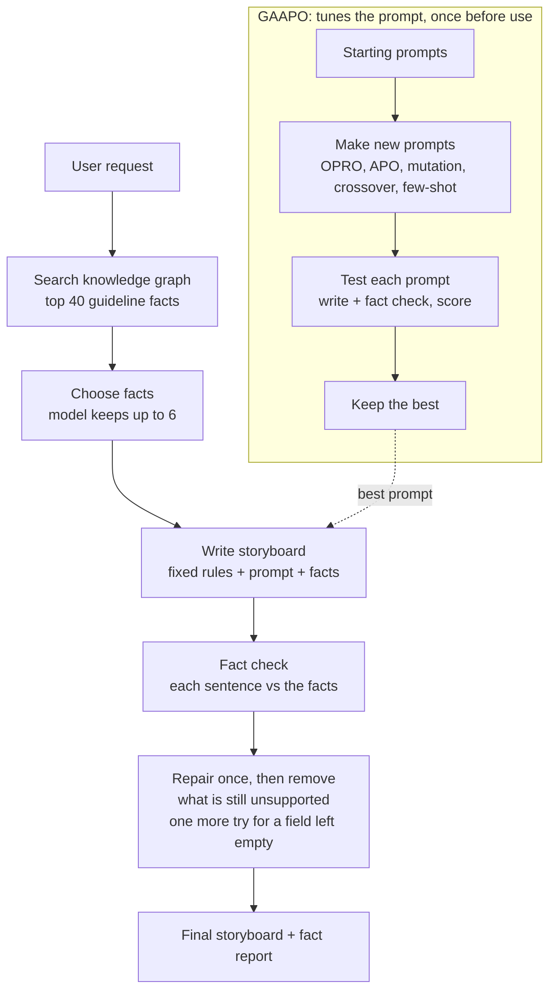

# Fact-checked storyboards for heart-failure patient videos

Patient-education storyboards should only say what the guidelines say. This adds a pipeline to the
thesis repo ([MahsaThesis-DigiStrucMed](https://github.com/SDM-TIB/MahsaThesis-DigiStrucMed)) that
writes each storyboard from guideline facts in the knowledge graph (GuideLineKG), checks every sentence
against those facts, and repairs or removes what is not supported. GAAPO is used to tune the writer's prompt.

## Pipeline

- **Writer and fact chooser:** `openai/gpt-oss-120b`. **Fact checker:** `openai/gpt-oss-20b`, a second model, so the writer does not grade itself. Both run on Groq's free plan.
- **Fact check labels:** SUPPORTED, CONTRADICTED or NOT_SUPPORTED, judged only on the given facts. The one-sentence check used by the pipeline also has NO_CLAIM (a greeting, a thank-you, "ask your care team"); only SUPPORTED and NO_CLAIM sentences stay. In this check the model does not pick the label: it fills in a short checklist (is it a medical statement, which fact, who the fact and the sentence are about, what the sentence adds, any conflict) and the code decides.
- **GAAPO score:** fact support (counts double), fact coverage, readability, format. Refusals and empty answers score 0.
- The fine-tuned Llama 3.2 1B adapter is not used. In our test it answered "false" to 28 of 30 claims, true and false alike, so it could not serve as the fact checker.

## What we found

1. **The fact checker works.** Before use it had to pass marks set in advance, on 30 true and false claims and 16 real storyboard sentences: it never called a false claim supported. `gpt-oss-20b` passed the same marks; `qwen3.8-27b` did not (13 of 16 vs 15 needed).
2. **The pipeline gives fact-backed storyboards.** On 6 medicine topics, 17 of 18 first-draft sentences were supported, and every sentence in the final storyboards is. See `GALLM/runs/grounded-v1/report.md`.
3. **GAAPO did not find a better prompt.** Over 2 rounds, none of its 10 new prompts beat the best starting prompt on the tuning topics (0.94). Best new prompts: mutation 0.88, OPRO 0.86; APO was weakest (0.58).
4. **Inside the pipeline, prompt wording matters less than the facts and rules.** Scores on 6 unseen test topics:

| Prompt in the Write step | Total | Fact support | Fact coverage | Valid format |
|---|---|---|---|---|
| Thesis best GAAPO prompt (`University-GuidelineQA/web/gaapo/best_prompt.txt`) | 0.73 | 0.88 | 0.89 | 0 of 6 |
| Same prompt + one line: scene_number is a number, not text | 0.81 | 0.79 | 0.64 | 5 of 6 |
| GAAPO's pick (GAAPO's own starting prompt) | 0.76 | 0.72 | 0.67 | 5 of 6 |

The thesis prompt writes `"scene_number": "1"` (text), which the format check scores 0; one added line fixes this on 5 of 6 topics.

5. **On all 27 covered topics the pipeline holds up.** With that prompt (`GALLM/runs/grounded-27/summary.json`):

| | Result |
|---|---|
| Storyboards | 25 of 27 (1 topic had no facts; 1 answer listed its scenes under "scenarios" instead of "scenes") |
| First drafts | 88 of 96 sentences supported |
| Final storyboards | 93 sentences kept, all supported; 2 removed |
| Valid format | 24 of 25 (1 has no on-screen text) |

The writer, and sometimes its repair, still wrote some scene numbers as text, so the pipeline now turns them into numbers. This changes format only, not words, and took valid format from 20 to 24 of 25.

6. **A doctor-talk style works, once the checker is stricter.** `--style doctor` writes 3 scenes (greet, explain, one thing to do) on the 6 medicine topics, with the same facts and checker. A doctor's talk needs sentences with no medical claim, hence NO_CLAIM. The first run showed the checker passing small additions, so SUPPORTED was tightened: no added time, frequency or stronger wording, and nothing proven for one group said for everyone. Both changes passed marks set in advance.

| Run | Checker | Sentences removed | Valid format |
|---|---|---|---|
| First run | NO_CLAIM added | 0 | 6 of 6 |
| Stricter | SUPPORTED tightened | 5 | 4 of 6 |
| Stricter + refill (`GALLM/runs/doctor-talk-refill`) | same, plus one more try for a field the removal left empty | 5 | 6 of 6 |

The stricter checker caught "take your beta-blocker daily", "heal heart", "life-threatening", and benefits proven only for reduced ejection fraction (HFrEF) said for everyone.

7. **A checklist makes the checker safer.** The checker was not consistent on group claims (see Limits), so the one-sentence check became a checklist that the code turns into a label. In a test with marks set in advance it kept none of the false or stretched sentences. The three doctor-talk runs above were made before this change.

## Limits

- **6 test topics is a small test.** One added line moved the fact scores by up to 0.25, so these totals are not a proven ranking.
- **The knowledge graph holds the guidelines' table text, not their running paragraphs.** Of the 45 topics, 13 are fully covered, 14 partly and 18 not at all. Topics without facts get no storyboard, by design.
- **The checker judges against the given facts only,** not against medical truth in general. A sentence can be marked supported and still be wrong in context, so a clinician should read the final storyboards.
- **The checker (`gpt-oss-20b`) is not consistent on group claims.** In `doctor-talk-refill`, ruler-012, it removed "It can reduce hospital visits and death" (proven only for HFrEF), then passed a near-identical claim in the refilled sentence. It also removed a plain topic line in ruler-014, and passed hospital potassium monitoring turned into patient advice in ruler-017. These runs used the check before the checklist.
- **The checklist check is too strict.** It cut some true sentences: 3 of 4 plain "ask your care team about <medicine>" lines and 2 of 5 true sentences in everyday words. A cut sentence makes a storyboard shorter, not wrong.

## Files

| Path | What it is |
|---|---|
| `GALLM/grounded_pipeline.py` | The pipeline: search, choose facts, write, check, repair, report |
| `GALLM/fact_check.py` | The fact checker (one sentence, or a whole storyboard in one call) |
| `GALLM/editor_gaapo.py`, `GALLM/editor.config.json` | GAAPO on the writer's prompt, with the fact-based score |
| `GALLM/scorecard.py` | Readability and format checks; refusals score 0 |
| `GALLM/run_grounded_topics.py` | The pipeline on all 27 covered topics, or the doctor-talk style on the 6 medicine topics |
| `GALLM/prompts/doctor_style.txt` | The doctor-talk style prompt |
| `GALLM/core.py`, `experiment.py`, `gaapo_rerun.py`, `models.py` | Shared helpers the code above imports |
| `GALLM/data/editor_topics.json` | The 6 tuning and 6 test topics, each with its chosen guideline facts |
| `GALLM/runs/` | Results: `grounded-v1` (6 storyboards; GAAPO also uses them as examples), `editor-gaapo-01` (GAAPO run: scores per round, test result, best prompt, all prompts tried), `grounded-27` (27 topics; `prompt_example_ruler-012.txt` shows one full writer prompt and answer), `kg-coverage/coverage_review.json` (which of the 45 topics the graph covers), `doctor-talk-refill` (the doctor talks), `rerun-02/best_prompt.txt` (a GAAPO starting prompt) |
| `GALLM/tests/` | Unit tests |

The topic requests are short one-scene rewrites of topics from the students' exchanges.

## How to run

The code imports GAAPO from the thesis repo and reads the knowledge graph from it, so it runs from that repo's root.

1. Clone the thesis repo, then copy this repo's `GALLM/` folder into its root.
2. Put a Groq key in `GAAPO/.env` as `GROQ_API_KEY=...`.
3. Install: `pip install openai python-dotenv`.
4. Run the tests: `python -m unittest GALLM.tests.test_fact_check GALLM.tests.test_grounded_pipeline GALLM.tests.test_editor_gaapo GALLM.tests.test_scorecard`.
5. Run GAAPO on the writer's prompt: `python -m GALLM.editor_gaapo --output GALLM/runs/my-run`. Add `--dry-run` to check the wiring with fake models in seconds.
6. Run the pipeline on the 27 covered topics: `python -m GALLM.run_grounded_topics`. Add `--only ruler-012` for a single topic.
7. Run the doctor-talk style: `python -m GALLM.run_grounded_topics --style doctor`.

Every model call is saved to disk, so a run stopped by Groq's daily limit continues where it stopped.
